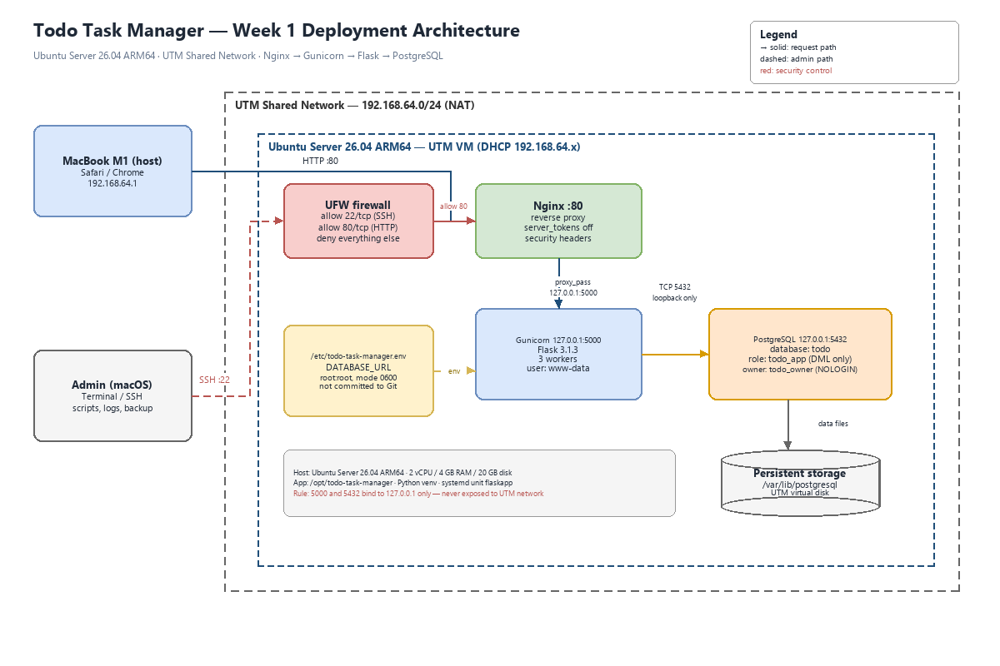
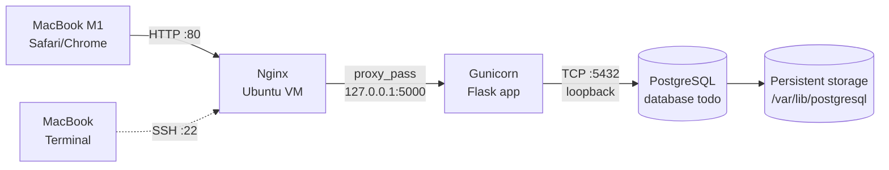

# Todo Task Manager — DevOps Final Project (Week 1)

**Môn:** DevOps — HK 2026<br>
**Hình thức:** Group project<br>
**Repo:** <https://github.com/Huybao312/Final-Devops><br>
**Môi trường demo:** Ubuntu Server 26.04 LTS ARM64 trên UTM (MacBook M1), UTM Shared Network

## 1. Thành viên và phân công

| Họ và tên | Vai trò | Phụ trách chính | Minh chứng |
|---|---|---|---|
| Lê Hoàng Tùng | Nhóm trưởng | Hạ tầng UTM/Ubuntu, PostgreSQL, systemd, Nginx, kiến trúc, README, demo | Commit + `docs/evidence/server-info.txt` |
| Phùng Ngô Huy Bảo | Thành viên | Ứng dụng Flask ban đầu, CRUD, template, review bản migration PostgreSQL | Commit review + test CRUD |
| Đào Tuấn Bảo | Thành viên | Kiểm thử chức năng, chạy `verify-app.sh`, thu log/ảnh, troubleshooting playbook | Commit evidence + ảnh/log |

> Bảng này là **phân công**, không phải tuyên bố đã hoàn thành. Mỗi thành viên phải có ít nhất một commit thật trước buổi demo; cập nhật nhật ký tại [`docs/team/contribution-log.md`](docs/team/contribution-log.md).

## 2. Mục tiêu Week 1

Checkpoint: **Deploy a Working Application** — tối đa 2.0/10 điểm.

- [x] Chọn ứng dụng Web có database, ghi rõ nguồn code.
- [x] Thiết kế kiến trúc triển khai: client → Nginx → app → PostgreSQL → storage.
- [ ] Cài Ubuntu Server trên UTM, ghi phiên bản OS và tài nguyên.
- [ ] Cấu hình SSH, user, firewall/port.
- [ ] Cài môi trường chạy, kết nối DB, chứng minh ghi/đọc một bản ghi thật.
- [ ] Repo + README cài đặt thủ công + phân công.

## 3. Ứng dụng

**Todo Task Manager** — ứng dụng quản lý công việc:

- Tạo task (title + description).
- Sửa task.
- Đánh dấu hoàn thành / bỏ hoàn thành.
- Xóa task.
- `GET /health` kiểm tra app và kết nối database.

**Nguồn code:** ứng dụng do nhóm tự phát triển, không dùng app mã nguồn mở bên ngoài. Phùng Ngô Huy Bảo xây dựng phiên bản Flask + SQLite đầu tiên; Lê Hoàng Tùng chuyển lớp database sang PostgreSQL và triển khai hạ tầng. Không có code nghiệp vụ nào lấy từ nguồn khác.

**Phạm vi tự triển khai:**

| Hạng mục | Nhóm tự làm | Thành phần dùng sẵn |
|---|---|---|
| Ứng dụng | CRUD task, template HTML, schema PostgreSQL, migration SQLite → PostgreSQL | Flask, psycopg, Gunicorn |
| Hạ tầng | Cấu hình UTM/Ubuntu, PostgreSQL role/database, Nginx, systemd, UFW, network | Ubuntu Server, PostgreSQL, Nginx |
| Deploy & vận hành | `bootstrap.sh`, `setup-db.sh`, `verify-app.sh`, `server-info.sh`, `deploy.sh`, systemd/Nginx config | Git, GitHub |
| Tài liệu | README, architecture, demo script, evidence checklist | draw.io |

**Vì sao chuyển từ SQLite sang PostgreSQL?**

- Week 2 yêu cầu `docker-compose.yml` có **application, database, network, persistent volume**; SQLite không có database service riêng.
- Week 3 yêu cầu **phân quyền database** và **hạn chế truy cập database**; PostgreSQL có role/privilege và network boundary để chứng minh.
- Backup/restore bằng `pg_dump`/`pg_restore` rõ ràng hơn, phù hợp Week 3.
- SQLite vẫn là bản prototype hợp lệ ở Week 1, nhưng không phải lựa chọn kỹ thuật tốt cho toàn bộ đồ án.

## 4. Kiến trúc



Sơ đồ: [`docs/architecture.png`](docs/architecture.png); giải thích chi tiết tại [`docs/architecture.md`](docs/architecture.md).



### Thành phần

| Thành phần | Công nghệ | Vị trí / cổng | Vai trò |
|---|---|---|---|
| Client | Safari/Chrome trên macOS | `192.168.64.1` (UTM host) | Người dùng cuối |
| Network | UTM Shared Network | `192.168.64.0/24` | NAT, host ↔ VM |
| Firewall | UFW | VM | Chỉ mở 22/tcp, 80/tcp |
| Reverse proxy | Nginx | VM, `0.0.0.0:80` | Nhận HTTP, chuyển tới Gunicorn |
| App server | Gunicorn | VM, `127.0.0.1:5000` | Chạy Flask, 3 worker |
| Application | Flask 3.1.3 | `/opt/todo-task-manager` | CRUD task |
| Database | PostgreSQL | VM, `127.0.0.1:5432` | Lưu dữ liệu |
| Storage | UTM virtual disk | `/var/lib/postgresql` | Dữ liệu bền vững |
| Process manager | systemd | unit `flaskapp` | Tự khởi động, restart khi lỗi |

### Luồng truy cập

1. Người dùng mở `http://<VM_IP>/` trên trình duyệt của Mac.
2. Gói tin đi qua UTM Shared Network tới IP của VM.
3. UFW cho phép cổng 80; Nginx nhận request.
4. Nginx `proxy_pass` sang Gunicorn tại `127.0.0.1:5000`.
5. Flask dùng `DATABASE_URL` kết nối PostgreSQL tại `127.0.0.1:5432`.
6. PostgreSQL đọc/ghi bảng `tasks`; dữ liệu nằm trên virtual disk của UTM.
7. Response quay lại Nginx → trình duyệt.

### Bảng port

| Port | Giao thức | Bind | Ai truy cập được | Mục đích |
|---|---|---|---|---|
| 22 | TCP | `0.0.0.0` | Mac host | SSH quản trị |
| 80 | TCP | `0.0.0.0` | Mac host (UTM network) | HTTP qua Nginx |
| 5000 | TCP | `127.0.0.1` | Chỉ trong VM | Gunicorn |
| 5432 | TCP | `127.0.0.1` | Chỉ trong VM | PostgreSQL |

> Không mở 5000 hoặc 5432 ra UTM network. Nếu `ss -lntp` cho thấy các cổng này bind `0.0.0.0`, phải sửa cấu hình — đó là lỗi bảo mật, không phải "tạm chấp nhận được".

## 5. Stack và phiên bản

| Layer | Công nghệ | Phiên bản |
|---|---|---|
| OS | Ubuntu Server 26.04 LTS ARM64 | ghi từ `/etc/os-release` |
| Runtime | Python 3 + venv | ghi từ `python3 --version` |
| Web framework | Flask | 3.1.3 |
| WSGI server | Gunicorn | 26.2.0 |
| PostgreSQL driver | psycopg | 3.3.6 |
| Database | PostgreSQL | bản trong repo Ubuntu 26.04; ghi từ `psql --version` |
| Reverse proxy | Nginx | bản trong repo Ubuntu 26.04; ghi từ `nginx -v` |
| Process manager | systemd | của Ubuntu |
| Firewall | UFW | của Ubuntu |

Phiên bản Python/PostgreSQL/Nginx thực tế phải được ghi lại trong `docs/evidence/server-info.txt` sau khi cài.

## 6. Yêu cầu hạ tầng

- MacBook M1 chạy UTM.
- Ubuntu Server 26.04 LTS **ARM64** đã cài trong UTM.
- Tài khoản có quyền `sudo`, SSH bật. Nếu chưa có SSH, mở UTM console và chạy:
  ```bash
  sudo apt update
  sudo apt install -y openssh-server
  sudo systemctl enable --now ssh
  ```
- Tối thiểu: 2 vCPU, 4 GB RAM, 20 GB disk. Kiểm tra bằng:
  ```bash
  nproc
  free -h
  df -h /
  ```
- UTM network: **Shared Network**. Mac host truy cập VM qua IP `192.168.64.x`.
- Không cần public IP, domain hay mở port trên router vì demo trên chính máy Mac.
- IP của VM có thể đổi sau khi reboot; luôn kiểm tra:
  ```bash
  hostname -I
  ```
- Nếu `free -h` cho thấy RAM dưới 2 GB, giảm `--workers 3` xuống `--workers 2` trong `systemd/flaskapp.service` trước khi chạy bootstrap. Với 4 GB RAM, cấu hình 3 worker là thoải mái.

## 7. Cài đặt nhanh (khuyến nghị)

Chạy trên Ubuntu VM, trong tài khoản có `sudo`:

```bash
sudo apt update
sudo apt install -y git

sudo mkdir -p /opt/todo-task-manager
sudo chown "$USER":www-data /opt/todo-task-manager
git clone https://github.com/Huybao312/Final-Devops.git /opt/todo-task-manager

cd /opt/todo-task-manager
sudo bash scripts/bootstrap.sh
```

Script `bootstrap.sh` thực hiện:

1. Cài `python3-venv`, `python3-pip`, `postgresql`, `nginx`, `curl`, `git`, `ufw`, `openssl`.
2. Tạo virtualenv và cài đúng phiên bản trong `requirements.txt`.
3. Tạo PostgreSQL role/database, áp schema, phân quyền tối thiểu.
4. Ghi `/etc/todo-task-manager.env` (root:root, 0600).
5. Cài systemd unit `flaskapp` và Nginx site.
6. Cấu hình UFW: chỉ 22/tcp và 80/tcp.
7. Khởi động app và kiểm tra `http://127.0.0.1/health`.

Sau khi chạy xong:

```bash
hostname -I
# Mở trên Mac: http://<IP>/
```

> `bootstrap.sh` chỉ chạy khi repo nằm đúng `/opt/todo-task-manager`. Đây là đường dẫn được systemd unit và README tham chiếu; không đổi đường dẫn tùy tiện.

## 8. Cài đặt thủ công (theo rubric Week 1)

Dùng khi cần giải thích từng bước hoặc khi `bootstrap.sh` gặp lỗi.

### 8.1. Cài package

```bash
sudo apt update
sudo apt install -y python3-venv python3-pip postgresql nginx curl git ufw openssl
```

### 8.2. Lấy source code

```bash
sudo mkdir -p /opt/todo-task-manager
sudo chown "$USER":www-data /opt/todo-task-manager
git clone https://github.com/Huybao312/Final-Devops.git /opt/todo-task-manager
cd /opt/todo-task-manager
```

### 8.3. Tạo virtualenv

```bash
python3 -m venv venv
./venv/bin/pip install --disable-pip-version-check -r requirements.txt
```

### 8.4. Phân quyền để `www-data` đọc được app

```bash
sudo chown -R "$USER":www-data /opt/todo-task-manager
sudo chmod -R o-rwx /opt/todo-task-manager
sudo chmod -R g+rX /opt/todo-task-manager
```

### 8.5. Tạo database và secret

```bash
sudo bash scripts/setup-db.sh
```

Script tạo:

- Role `todo_owner` (NOLOGIN) sở hữu database/table.
- Role `todo_app` (LOGIN) chỉ có `SELECT`, `INSERT`, `UPDATE`, `DELETE`.
- Database `todo`.
- File `/etc/todo-task-manager.env` chứa `DATABASE_URL`, quyền `0600`, owner `root:root`.

Kiểm tra:

```bash
sudo ls -l /etc/todo-task-manager.env
# -rw------- 1 root root ... /etc/todo-task-manager.env
```

### 8.6. Cài systemd unit

```bash
sudo install -m 0644 systemd/flaskapp.service /etc/systemd/system/flaskapp.service
sudo systemctl daemon-reload
sudo systemctl enable --now flaskapp
sudo systemctl status flaskapp --no-pager
```

### 8.7. Cài Nginx

```bash
sudo install -m 0644 nginx/flaskapp /etc/nginx/sites-available/flaskapp
sudo ln -sf /etc/nginx/sites-available/flaskapp /etc/nginx/sites-enabled/flaskapp
sudo rm -f /etc/nginx/sites-enabled/default
sudo nginx -t
sudo systemctl reload nginx
```

### 8.8. Cấu hình firewall

```bash
sudo bash scripts/setup-firewall.sh
```

Kết quả mong đợi:

```text
22/tcp     ALLOW       Anywhere
80/tcp     ALLOW       Anywhere
```

### 8.9. Kiểm tra

```bash
curl -fsS http://127.0.0.1/health
# {"status":"healthy"}

hostname -I
# Mở trên Mac: http://<IP>/
```

## 9. Kiểm chứng đọc/ghi dữ liệu

### Cách 1: qua giao diện

1. Mở `http://<VM_IP>/`.
2. Nhập title/description, bấm **Add task**.
3. Sửa, đánh dấu hoàn thành, xóa thử.
4. Refresh trang — dữ liệu vẫn còn.

### Cách 2: script tự động

```bash
sudo bash scripts/verify-app.sh
```

Script thực hiện:

1. Gọi `/health`.
2. `POST /tasks` tạo task qua Nginx.
3. `GET /` đọc lại và kiểm tra task xuất hiện.
4. Query trực tiếp PostgreSQL để thấy cùng bản ghi.
5. Toggle task và kiểm tra cột `completed`.
6. Kiểm tra quyền của role `todo_app` (không có quyền tạo object).

Output được lưu tại `docs/evidence/verify-app.txt`.

### Cách 3: query thủ công

```bash
sudo -u postgres psql -d todo -c \
  "SELECT id, title, completed, created_at FROM tasks ORDER BY id DESC LIMIT 5;"
```

Kiểm tra phân quyền:

```bash
sudo -u postgres psql -d todo -c "\dp public.tasks"
```

## 10. Kiểm tra server, port và firewall

```bash
sudo bash scripts/server-info.sh
```

Output tại `docs/evidence/server-info.txt`, gồm OS, kernel, CPU, RAM, disk, IP, port đang listen, UFW, trạng thái service, phiên bản phần mềm, user hiện tại, cấu hình SSH và health check.

### 10.1. User và SSH

Dùng một user thường có quyền `sudo`, không đăng nhập bằng `root`:

```bash
whoami
id
sudo -l
```

Kiểm tra cấu hình SSH thực tế:

```bash
sudo sshd -T | grep -E '^(port|permitrootlogin|passwordauthentication|pubkeyauthentication|allowusers|allowgroups)'
sudo systemctl status ssh --no-pager
sudo ufw status verbose
```

Khuyến nghị:

- `PermitRootLogin no` hoặc tối thiểu `prohibit-password`; không để `yes`.
- Ưu tiên SSH key; nếu dùng password cho demo local, dùng password mạnh và chỉ mở SSH trong UTM network.
- Trước khi sửa `sshd_config`, giữ console UTM mở để tránh bị khóa.
- UFW phải allow OpenSSH trước khi enable.

Nếu `permitrootlogin yes`, sửa:

```bash
sudo nano /etc/ssh/sshd_config
# PermitRootLogin no
sudo sshd -t
sudo systemctl reload ssh
```

Sau đó chụp `sshd -T` + `ufw status` làm evidence.

Kiểm tra nhanh:

```bash
sudo ss -lntp
sudo ufw status verbose
systemctl status flaskapp nginx postgresql --no-pager
```

Kỳ vọng:

- `sshd` listen 22.
- `nginx` listen 80.
- `gunicorn` listen `127.0.0.1:5000`.
- `postgres` listen `127.0.0.1:5432`.
- UFW chỉ allow 22, 80.

## 11. Bảo mật và vận hành

| Kiểm soát | Cách làm | Minh chứng |
|---|---|---|
| Firewall | UFW default deny incoming; chỉ allow 22, 80 | `ufw status verbose` |
| DB không lộ mạng | PostgreSQL bind `127.0.0.1` | `ss -lntp` |
| App không lộ trực tiếp | Gunicorn bind `127.0.0.1:5000` | `ss -lntp` |
| Least privilege | `todo_app` chỉ DML; `todo_owner` NOLOGIN | `\dp public.tasks` |
| Secret | `/etc/todo-task-manager.env`, 0600 root:root | `ls -l` |
| Không commit secret | `.gitignore` chặn `.env`, `*.env`, dump | `git status` |
| Chạy app | systemd `User=www-data`, hardening | `systemctl cat flaskapp` |
| HTTP headers | `X-Content-Type-Options`, `X-Frame-Options`, `Referrer-Policy` | `curl -I` |
| Nginx | `server_tokens off` | `curl -I` |

**Giới hạn có chủ ý ở Week 1:**

- Chưa có HTTPS/TLS vì demo local trong UTM network, không có domain công khai.
- Chưa có đăng nhập/CSRF — ứng dụng demo một người dùng; nếu giảng viên yêu cầu, bổ sung ở Week 3.
- `scripts/deploy.sh` là **manual deployment**, chưa phải CI/CD. Week 2 sẽ thay bằng GitHub Actions + self-hosted runner.

Không được làm:

- Không `chmod 777`.
- Không đưa password/token vào repo, README, video hoặc screenshot.
- Không mở 5000/5432 ra ngoài để "cho nhanh".
- Không tắt UFW để debug.

## 12. Bằng chứng nộp bài

Xem checklist chi tiết tại [`docs/evidence/README.md`](docs/evidence/README.md).

Tối thiểu cần có:

- `docs/architecture.png` (đã có sẵn trong repo).
- `docs/evidence/server-info.txt`.
- `docs/evidence/verify-app.txt`.
- Ảnh chụp giao diện app: danh sách task, form tạo, task sau khi sửa/toggle.
- Ảnh/log `systemctl status flaskapp`, `nginx`, `postgresql`.
- Ảnh `ufw status verbose`, `ss -lntp`.
- Video demo dự phòng 3–5 phút.

## 13. Troubleshooting

### 13.1. `502 Bad Gateway`

**Triệu chứng:** mở IP của VM thấy Nginx báo 502.<br>
**Kiểm tra:**
```bash
systemctl status flaskapp --no-pager
journalctl -u flaskapp -n 100 --no-pager
curl -v http://127.0.0.1:5000/health
```
**Nguyên nhân thường gặp:** Gunicorn chết, thiếu `DATABASE_URL`, sai quyền đọc file, PostgreSQL chưa chạy.<br>
**Khắc phục:** sửa nguyên nhân trong log, `sudo systemctl restart flaskapp`.<br>
**Phòng tránh:** health check sau mỗi lần deploy; giữ `Restart=always`.

### 13.2. `RuntimeError: DATABASE_URL is not set`

**Kiểm tra:**
```bash
sudo ls -l /etc/todo-task-manager.env
sudo systemctl show flaskapp -p EnvironmentFiles
```
**Nguyên nhân:** chưa chạy `setup-db.sh` hoặc file bị xóa/sai đường dẫn.<br>
**Khắc phục:** `sudo bash scripts/setup-db.sh`, sau đó `sudo systemctl restart flaskapp`.<br>
**Phòng tránh:** đưa bước setup DB vào checklist cài đặt.

### 13.3. `psycopg.OperationalError: connection refused`

**Kiểm tra:**
```bash
systemctl status postgresql --no-pager
sudo ss -lntp | grep 5432
```
**Nguyên nhân:** PostgreSQL chưa chạy hoặc bind sai địa chỉ.<br>
**Khắc phục:** `sudo systemctl start postgresql`; kiểm tra `listen_addresses` trong `postgresql.conf`.<br>
**Phòng tránh:** systemd unit có `Requires=postgresql.service`.

### 13.4. `permission denied for table tasks`

**Kiểm tra:**
```bash
sudo -u postgres psql -d todo -c "\dp public.tasks"
```
**Nguyên nhân:** role `todo_app` thiếu grant hoặc bảng thuộc role khác.<br>
**Khắc phục:** chạy lại `sudo bash scripts/setup-db.sh` (idempotent).<br>
**Phòng tránh:** không sửa grant thủ công bằng tài khoản `postgres` mà không ghi lại.

### 13.5. Nginx vẫn hiện trang mặc định

**Kiểm tra:**
```bash
ls -l /etc/nginx/sites-enabled/
sudo nginx -t
```
**Nguyên nhân:** file `default` vẫn còn, hoặc symlink `flaskapp` chưa đúng.<br>
**Khắc phục:**
```bash
sudo rm -f /etc/nginx/sites-enabled/default
sudo ln -sf /etc/nginx/sites-available/flaskapp /etc/nginx/sites-enabled/flaskapp
sudo nginx -t && sudo systemctl reload nginx
```

### 13.6. SSH bị khóa sau khi bật UFW

**Khắc phục:** mở console UTM, đăng nhập trực tiếp, chạy:
```bash
sudo ufw allow OpenSSH
sudo ufw reload
```
**Phòng tránh:** luôn allow SSH trước khi `ufw enable`.

### 13.7. Safari/Chrome trên Mac không mở được `http://<VM_IP>/`

**Kiểm tra từ Mac:**
```bash
ping -c 3 <VM_IP>
```

**Trên VM:**
```bash
systemctl status nginx --no-pager
sudo ufw status verbose
ss -lntp | grep ':80'
```

**Nguyên nhân thường gặp:** UTM network không phải Shared, IP đổi sau reboot, Nginx chưa chạy, hoặc UFW thiếu rule 80.<br>
**Khắc phục:** sửa theo nguyên nhân; nếu vẫn không được, thêm port forward trong UTM (host `8080` → guest `80`) và mở `http://localhost:8080/` trên Mac.<br>
**Phòng tránh:** kiểm tra `hostname -I` ngay trước demo; giữ ảnh/video dự phòng.

## 14. Vận hành

```bash
# Xem log app
journalctl -u flaskapp -f

# Xem log Nginx
sudo tail -f /var/log/nginx/todo-access.log
sudo tail -f /var/log/nginx/todo-error.log

# Restart app
sudo systemctl restart flaskapp

# Deploy bản mới (manual, Week 1)
./scripts/deploy.sh

# Vào PostgreSQL
sudo -u postgres psql -d todo
```

## 15. Tuần 2 — Containerization & CI/CD

Đã triển khai `Dockerfile`, `compose.yaml`, test tích hợp PostgreSQL và GitHub Actions trên Ubuntu VM UTM. Xem [hướng dẫn triển khai tuần 2](docs/week2.md) và [bằng chứng thực tế](docs/evidence/README.md).

### Đã kiểm chứng trên VM

- Chuyển 4 bản ghi từ PostgreSQL tuần 1 sang named volume; số bản ghi và checksum trùng khớp.
- Self-hosted runner Linux ARM64 chạy bằng systemd; secrets nằm trong GitHub Actions, không ở repo.
- Workflow `build-test → deploy` xanh sau push `main`; `/version` trả đúng SHA commit được deploy.
- `scripts/verify-week2.sh` xác nhận task còn sau `docker compose down && up`.
- Log và ảnh trước–sau deploy nằm trong `docs/evidence/`.

`scripts/deploy.sh` thuộc quy trình thủ công tuần 1; pipeline tuần 2 dùng `.github/workflows/week2.yml`.

## 16. Tài liệu tham khảo

- Flask: <https://flask.palletsprojects.com/>
- Gunicorn: <https://docs.gunicorn.org/>
- psycopg 3: <https://www.psycopg.org/psycopg3/docs/>
- PostgreSQL roles/privileges: <https://www.postgresql.org/docs/current/user-manag.html>
- Nginx reverse proxy: <https://docs.nginx.com/nginx/admin-guide/web-server/reverse-proxy/>
- UTM: <https://docs.getutm.app/>
