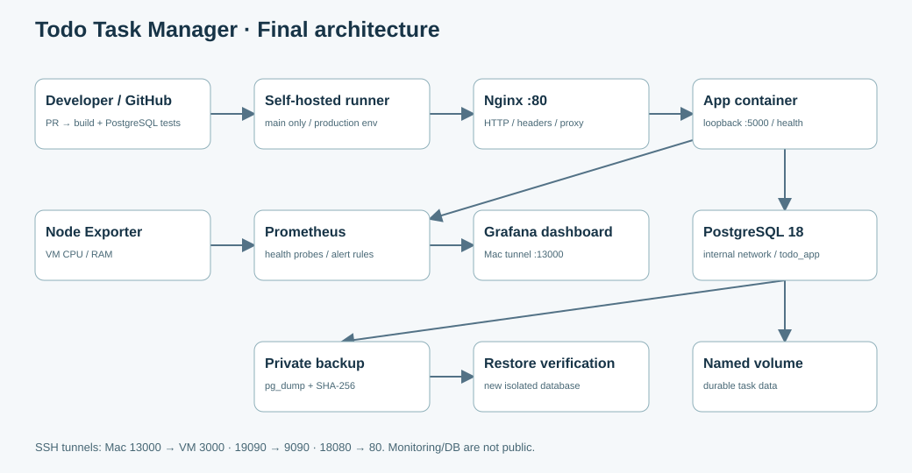

# Todo Task Manager — DevOps Final Project 2026

Flask/Gunicorn + PostgreSQL 18, Docker Compose, Nginx, GitHub Actions, Prometheus/Grafana. Bản tích hợp tuần 1–4; hướng dẫn systemd tuần 1 là tài liệu lịch sử, không phải đường cài đặt bản cuối.

## Nộp bài

Xem [hướng dẫn nộp và trạng thái minh chứng](SUBMISSION.md).

## Điểm bắt đầu

- [Triển khai từ Ubuntu sạch](docs/week4/DEPLOYMENT.md)
- [Vận hành, ports, secrets, backup/restore](docs/week3/README.md)
- [Sơ đồ kiến trúc cuối](docs/week4/ARCHITECTURE.md)
- [Playbook ≥3 sự cố và phòng tránh](docs/week4/PLAYBOOK.md)
- [Technical paper](docs/week4/REPORT.md)
- [Ma trận yêu cầu và minh chứng](docs/week4/ACCEPTANCE.md)
- [Hồ sơ phát hành](docs/week4/RELEASE.md)

## Kiến trúc vận hành

Browser → Nginx host :80 → app container loopback :5000 → PostgreSQL trên internal network → named volume. Self-hosted ARM64 runner nhận deployment của commit main đã qua build/test. Monitoring chạy trong Compose project riêng, chỉ bind loopback. App không có xác thực người dùng; môi trường bảo vệ là VM local/LAN tin cậy, không tuyên bố là dịch vụ Internet multi-user.



## Các cổng thống nhất

| Dịch vụ | Trên Mac qua SSH tunnel | Trên VM |
|---|---|---|
| Grafana | http://localhost:13000 | 127.0.0.1:3000 |
| Prometheus | http://localhost:19090 | 127.0.0.1:9090 |
| App qua Nginx | http://localhost:18080 | :80 |
| App nội bộ | Không mở trực tiếp | 127.0.0.1:5000 |
| DB | Không publish host port | backend network :5432 |
| Exporters | Không mở từ Mac | 127.0.0.1:9100/9115 |

## Thành viên

Danh sách và phân công từ repo hiện có; từng thành viên phải xác nhận và thuyết minh phần việc thực sự thực hiện. Không suy diễn attribution commit thành đóng góp độc lập của từng người.

| Thành viên | Phân công đã ghi trong repo |
|---|---|
| Lê Hoàng Tùng | Hạ tầng, triển khai, kiến trúc |
| Phùng Ngô Huy Bảo | Ứng dụng, CRUD, review |
| Đào Tuấn Bảo | Kiểm thử, minh chứng, xử lý sự cố |

[Nhật ký đóng góp](docs/team/contribution-log.md) chỉ điền việc có bằng chứng và được người thực hiện xác nhận. Các thay đổi được hỗ trợ bởi coding agent cần được nhóm review, chạy lại và hiểu trước khi bảo vệ.

## Kiểm thử

CI chạy test CRUD/health với PostgreSQL thật, kiểm tra checksum backup, Prometheus alert rules và bài triển khai với volume/network mới cùng ba sự cố cô lập. Chạy `bash scripts/week4/rehearse.sh` trên Docker host để lặp lại bài diễn tập mà không dùng volume/secrets production. Nó giữ project thử nghiệm để Q&A; xem hướng dẫn cleanup trong deployment guide.

## Giới hạn và bảo mật

Secrets ở file riêng mode 600/GitHub Actions secrets; không commit mật khẩu, archive DB hoặc file môi trường. Firewall chỉ cho SSH/HTTP. HTTP đi qua mạng VM local hoặc SSH tunnel; chưa có TLS public, đăng nhập app hay HA. Backup VM-local và bản sao trên Mac không bảo vệ mất toàn bộ máy Mac; cần thiết bị/vị trí độc lập cho yêu cầu đó. Không dùng `down -v` với production.

Các ảnh/log tuần 2–3 được giữ làm lịch sử có ngày và SHA; minh chứng tuần 4 phải đối chiếu release hiện tại. [Tài liệu tuần 1 cũ](docs/week1-archive/README.md) chỉ dùng để giải thích tiến trình phát triển.

## Môi trường sửa code trên Mac

```bash
python3 -m venv venv
venv/bin/python -m pip install -r requirements-dev.txt
```

Trong VS Code chọn Python interpreter `venv/bin/python`. App cần `DATABASE_URL`; dùng Docker Compose theo deployment guide để chạy đầy đủ. Kiểm thử tích hợp cần PostgreSQL thử riêng, không đặt DATABASE_URL của test trỏ vào production.
