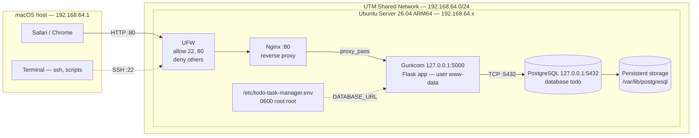

# Kiến trúc triển khai — Week 1

**Dự án:** Todo Task Manager  
**Môi trường:** Ubuntu Server 26.04 LTS ARM64 trên UTM (MacBook M1)  
**Mục tiêu:** ứng dụng Web + PostgreSQL chạy được, truy cập từ trình duyệt trên máy Mac, có firewall và phân quyền database tối thiểu.

## 1. Sơ đồ

Sơ đồ nguồn để chỉnh sửa: [`architecture.drawio`](architecture.drawio) (mở bằng draw.io / diagrams.net).  
Ảnh export: [`architecture.png`](architecture.png).

## 2. Thành phần

| Thành phần | Công nghệ | Vị trí | Vai trò |
|---|---|---|---|
| Client | Safari/Chrome | macOS host | Gửi request HTTP |
| Admin client | Terminal/SSH | macOS host | Quản trị, deploy, thu evidence |
| Network | UTM Shared Network | `192.168.64.0/24` | NAT giữa macOS và VM |
| Firewall | UFW | Ubuntu VM | Lọc ingress |
| Reverse proxy | Nginx | `0.0.0.0:80` | Nhận HTTP, chuyển tiếp |
| App server | Gunicorn | `127.0.0.1:5000` | WSGI, 3 worker |
| Application | Flask | `/opt/todo-task-manager` | CRUD task, `/health` |
| Database | PostgreSQL | `127.0.0.1:5432` | Lưu bảng `tasks` |
| Storage | UTM virtual disk | `/var/lib/postgresql` | Dữ liệu bền vững |
| Process manager | systemd | unit `flaskapp` | Start/restart, journald |
| Secrets | env file | `/etc/todo-task-manager.env` | `DATABASE_URL` |

## 3. Luồng request

1. Trình duyệt trên macOS mở `http://192.168.64.x/`.
2. Request đi qua UTM Shared Network tới VM.
3. UFW kiểm tra: cổng 80 được phép.
4. Nginx nhận request, thêm header `X-Real-IP`, `X-Forwarded-For`, `X-Forwarded-Proto`.
5. Nginx `proxy_pass` tới `http://127.0.0.1:5000`.
6. Gunicorn nhận request, chuyển cho Flask worker.
7. Flask mở connection PostgreSQL bằng `DATABASE_URL`, chạy câu SQL.
8. PostgreSQL đọc/ghi bảng `public.tasks`, dữ liệu nằm trên virtual disk.
9. Kết quả trả ngược Flask → Gunicorn → Nginx → trình duyệt.

## 4. Network và port

| Port | Bind | Nguồn được phép | Mục đích |
|---|---|---|---|
| 22/tcp | `0.0.0.0` | macOS host | SSH |
| 80/tcp | `0.0.0.0` | macOS host | HTTP qua Nginx |
| 5000/tcp | `127.0.0.1` | Local VM | Gunicorn |
| 5432/tcp | `127.0.0.1` | Local VM | PostgreSQL |

**Quyết định quan trọng:**

- Không bind Gunicorn ra `0.0.0.0`; chỉ Nginx được phép nói chuyện với app.
- Không bind PostgreSQL ra ngoài loopback; DB không bao giờ lộ ra UTM network.
- Không dùng port forwarding của UTM cho 5000/5432.
- IP của VM là DHCP; sau reboot phải kiểm tra lại `hostname -I`. Không hard-code IP vào cấu hình server.

## 5. Trust boundaries và kiểm soát

| Boundary | Kiểm soát | Minh chứng |
|---|---|---|
| macOS ↔ VM | UTM Shared Network + UFW | `ufw status verbose`, `ss -lntp` |
| Nginx ↔ Gunicorn | Loopback + systemd | `ss -lntp`, `systemctl status flaskapp` |
| Gunicorn ↔ PostgreSQL | Loopback + password + role DML-only | `\dp public.tasks`, `psql` |
| Secrets | File 0600 root:root, không commit | `ls -l /etc/todo-task-manager.env`, `git status` |
| App runtime | User `www-data`, systemd hardening | `systemctl cat flaskapp` |
| Repository | `.gitignore` chặn `.env`, dump, log | `git status` |

## 6. Database design và phân quyền

### Bảng `tasks`

| Cột | Kiểu | Ghi chú |
|---|---|---|
| `id` | `integer GENERATED ALWAYS AS IDENTITY` | Khóa chính |
| `title` | `text NOT NULL` | Check `length(btrim(title)) > 0` |
| `description` | `text NOT NULL DEFAULT ''` | Mô tả |
| `completed` | `boolean NOT NULL DEFAULT false` | Trạng thái |
| `created_at` | `timestamptz NOT NULL DEFAULT now()` | Thời điểm tạo |

Index: `tasks_completed_created_at_idx (completed, created_at DESC)` phục vụ truy vấn danh sách.

### Role

| Role | Login | Quyền | Mục đích |
|---|---|---|---|
| `todo_owner` | Không | Owner database, table, sequence | Sở hữu object; không dùng để login |
| `todo_app` | Có | `CONNECT`, `USAGE` schema, `SELECT/INSERT/UPDATE/DELETE`, `USAGE/SELECT` sequence | App runtime |
| `postgres` | Có | Superuser | Cài đặt/migration |

`todo_app` **không** có `CREATE`, `ALTER`, `DROP`, `TRUNCATE`. Nếu app bị lỗi injection, thiệt hại bị giới hạn ở dữ liệu, không phải cấu trúc DB.

### Vì sao không dùng SQLite cho bản cuối?

- SQLite là file trong container/app; Week 2 yêu cầu database service riêng trong Compose.
- Không có role/privilege/network boundary để chứng minh yêu cầu bảo mật Week 3.
- Backup/restore bằng `pg_dump`/`pg_restore` là quy trình chuẩn, dễ chứng minh hơn.
- SQLite phù hợp prototype Week 1 nhưng không đủ đất diễn cho Week 3–4.

## 7. Tài nguyên và UTM

- VM: 2 vCPU, 4 GB RAM, 20 GB disk (tối thiểu); kiểm tra thực tế bằng `nproc`, `free -h`, `df -h /`.
- UTM Shared Network: macOS host `192.168.64.1`; VM nhận DHCP trong `192.168.64.0/24`.
- VM có thể truy cập Internet qua NAT để `apt`, `pip`, `git`.
- Demo trên chính máy Mac: không cần public IP/domain.
- Nếu IP đổi sau reboot: mở UTM console, chạy `hostname -I`, dùng IP mới.

## 8. Failure modes

| Triệu chứng | Layer | Kiểm tra | Nguyên nhân thường gặp |
|---|---|---|---|
| 502 Bad Gateway | Nginx → Gunicorn | `journalctl -u flaskapp`, `curl 127.0.0.1:5000/health` | App chết, thiếu env, sai quyền |
| 503 `/health` | App → PostgreSQL | `systemctl status postgresql`, `psql` | DB chưa chạy, sai password |
| 500 Internal Server Error | Flask/DB | `journalctl -u flaskapp`, `\dp` | Thiếu grant, sai schema |
| Timeout / không kết nối | UTM/UFW | `ping`, `ufw status`, `ip a` | IP đổi, thiếu rule 80 |
| Trang mặc định Nginx | Nginx | `ls sites-enabled`, `nginx -t` | Default site còn bật |
| SSH bị từ chối | UFW | Console UTM | Chưa allow OpenSSH |

## 9. Chuẩn bị Week 2

Kiến trúc Week 1 cố ý tách lớp để chuyển sang container mà không đổi logic:

- `Dockerfile`: app + Gunicorn, không chứa secret.
- `docker-compose.yml`: service `app`, `db` (PostgreSQL), network `backend`, volume `pgdata`; Nginx có thể là service `proxy`.
- `db/schema.sql` mount vào `/docker-entrypoint-initdb.d/` cho lần khởi tạo đầu.
- GitHub Actions: checkout → build → pytest → build image → deploy.
- Self-hosted runner trên Ubuntu VM vì GitHub-hosted runner không SSH trực tiếp vào VM local.
- `scripts/deploy.sh` hiện tại là manual deploy, không được gọi là CI/CD.

## 10. Chỉnh sửa và export sơ đồ

1. Mở <https://app.diagrams.net/>.
2. **File → Open** → chọn `docs/architecture.drawio`.
3. Chỉnh sửa nếu cần.
4. **File → Export as → PNG**.
5. Lưu thành `docs/architecture.png` (giữ đúng tên để README hiển thị).
