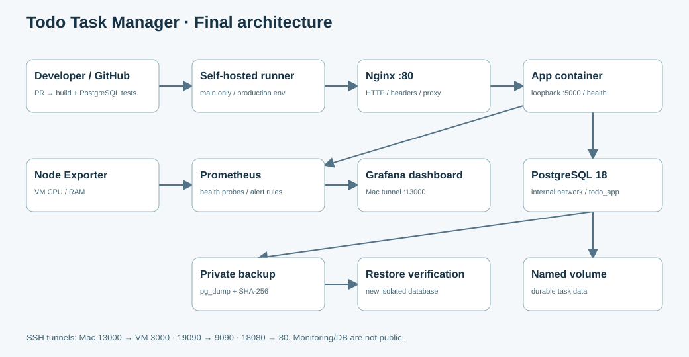
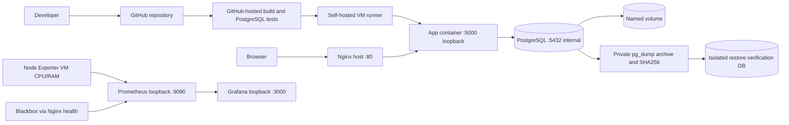

# Kiến trúc cuối

Production Compose project và monitoring Compose project độc lập. Backend DB network internal; app nối frontend/backend; proxy host chỉ gọi published loopback. Exporters dùng host namespace để số liệu là của VM Linux, không phải máy Mac. Grafana/Prometheus không publish ra LAN; quản trị đi qua SSH tunnel. Host PostgreSQL tuần 1 nếu còn chỉ phục vụ rollback và không phải DB của app hiện tại.

## Quyết định và đánh đổi

- PostgreSQL thay SQLite vì có service/network/role riêng và backup định dạng rõ ràng.
- Compose phù hợp một VM; không cần Kubernetes cho rubric này.
- Self-hosted runner có đường tới VM private nhưng đòi hỏi bảo vệ repo/workflow và quyền Docker.
- Blackbox đo đường Nginx → app → DB ở endpoint health, không chỉ kiểm tra process còn tồn tại.
- Restore vào DB riêng giữ an toàn dữ liệu hiện có; production cutover cần kế hoạch riêng.
- `/version` là SHA image build, giúp đối chiếu commit/run/app; nó không chứng minh toàn bộ host package giống nhau.
