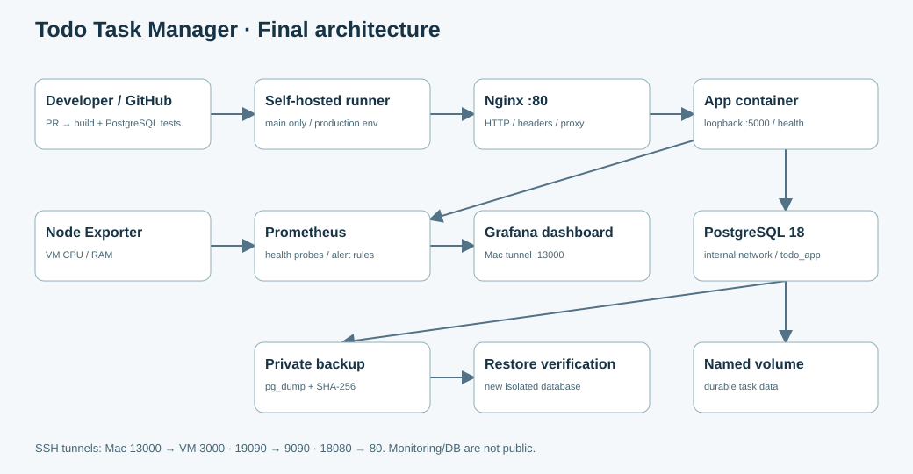
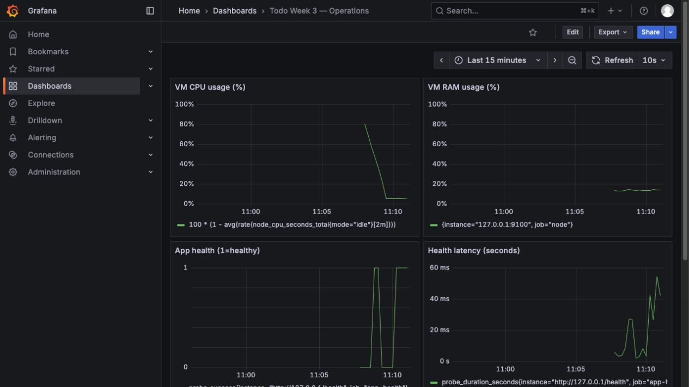

[Bản PDF đã render](REPORT.pdf)

# Tự động hóa triển khai và vận hành ứng dụng Web trên Ubuntu VM

Technical paper · DevOps Final Project 2026 · Bản tích hợp tuần 1–4

## Abstract

Đồ án xây dựng một quy trình triển khai có thể lặp lại cho Todo Task Manager, thay vì tập trung mở rộng chức năng nghiệp vụ. Ứng dụng Flask/Gunicorn ghi dữ liệu vào PostgreSQL 18 và được triển khai bằng Docker Compose sau kiểm thử GitHub Actions. Nginx là điểm truy cập HTTP; Prometheus, Node Exporter, Blackbox Exporter và Grafana cung cấp số liệu VM, trạng thái ứng dụng và cảnh báo. Script backup tạo archive kèm SHA-256; restore được xác minh trong database riêng để bảo vệ dữ liệu đang dùng. Bản cuối bổ sung hướng dẫn cài host sạch, kiểm tra đầu vào phía server, giới hạn thao tác DB và diễn tập ba lỗi độc lập. Kết quả thực nghiệm trên Ubuntu cho thấy các tình huống app dừng, DB dừng và proxy sai port đều được phát hiện, xác định nguyên nhân và phục hồi. Persistent volume giữ task sau container recreation; restore trả lại count và checksum trước khi xóa dữ liệu thử. Báo cáo phân biệt bằng chứng thực nghiệm với giới hạn chưa được kiểm chứng, bao gồm cài lại toàn bộ OS và các yêu cầu vận hành Internet nhiều người dùng.

## 1. Introduction

Mục tiêu là chứng minh chuỗi phát triển → kiểm thử → triển khai → quan sát → phục hồi. Trong một bài demo, trang web mở được chưa đủ: cần biết nó chạy commit nào, dữ liệu có nằm ngoài vòng đời container không và nhóm có giải thích được một lỗi tương tự 502 nhưng khác nguyên nhân hay không. Tiêu chí thành công được gắn với các kết quả quan sát cụ thể: HTTP health/version, job CI, dữ liệu trước/sau thao tác và log có timestamp. Cách tiếp cận này giảm phụ thuộc vào thao tác thủ công trên terminal mà người trình bày không hiểu.

## Phạm vi và nhóm

Môi trường là VM Ubuntu local trên UTM của Mac, cho phép dùng công cụ tương đương mà không cần cloud trả phí. Lê Hoàng Tùng phụ trách hạ tầng/kiến trúc; Phùng Ngô Huy Bảo phụ trách ứng dụng/CI; Đào Tuấn Bảo phụ trách kiểm chứng/vận hành. Đây là phân công đã được chủ repo xác nhận; nhật ký đóng góp và phần bảo vệ cá nhân cần phản ánh việc thực sự do từng thành viên thực hiện. Coding agent hỗ trợ chuẩn bị mã và tài liệu; nhóm chịu trách nhiệm review, chạy lại và giải thích.

<!-- PAGE -->

# 2. Architecture & Design

## Thiết kế đường dữ liệu

Nginx trên VM nhận request cổng 80 và proxy tới app được publish duy nhất tại loopback 5000. App truy cập PostgreSQL trên network backend internal; database không publish cổng host. Named volume là nơi giữ dữ liệu khi container bị thay thế. App chạy bằng user riêng trong image; role todo_app có quyền DML trên bảng tasks nhưng không được tạo table/role/database. Role sở hữu schema và dữ liệu được tách khỏi role đăng nhập ứng dụng.

## Đường triển khai và quản trị

Pull request chạy build image và pytest trên GitHub-hosted runner cùng PostgreSQL tạm. Push main chỉ deploy sau khi build-test thành công; self-hosted runner ARM64 có quyền Docker trong VM. Endpoint version lấy SHA được truyền vào image build, giúp đối chiếu commit, workflow và app. Monitoring là Compose project riêng để deploy app không làm mất dashboard. Từ Mac, SSH tunnel ánh xạ 13000→3000 (Grafana), 19090→9090 (Prometheus), 18080→80 (app).

## Lựa chọn và đánh đổi

PostgreSQL được chọn thay SQLite để có dịch vụ DB, network boundary, phân quyền và công cụ backup/restore rõ ràng. Compose đáp ứng phạm vi một VM và đơn giản hơn một nền tảng orchestration phân tán. Đổi lại, VM là điểm lỗi đơn và self-hosted runner có quyền mạnh: cần giới hạn người được sửa workflow/repo. Không suy luận rằng cấu hình Compose và một lần kiểm thử thành công đã đảm bảo high availability hoặc tái tạo bit-for-bit mọi dependency bên ngoài.

<!-- PAGE -->

# 3. Implementation & Reproducible Deployment

## Ứng dụng và bản vá cuối

App cung cấp CRUD task, bộ đếm task mở, health và version. SQL dùng tham số, template HTML tự escape dữ liệu. Audit phát hiện maxlength chỉ áp ở trình duyệt nên HTTP client vẫn gửi title quá dài hoặc ký tự NUL; bản cuối kiểm tra title tối đa 200 ký tự, description tối đa 1000, từ chối NUL và payload trên 64 KiB. Kết nối DB có connect timeout 3 giây, statement timeout 5 giây và lock timeout 2 giây; health trả 503 khi DB lỗi và chỉ log loại exception, không log DSN/password. ProxyFix chỉ tin các header mà Nginx cấu hình, tránh tin X-Forwarded-Host không cần thiết.

## Từ Ubuntu sạch

Deployment guide bắt đầu từ user Ubuntu có sudo/SSH, clone source, chạy install-host.sh để cài Docker từ apt repo chính thức, Nginx và UFW, rồi đăng nhập lại để nhóm docker có hiệu lực. deploy-clean.sh tạo hoặc dùng lại file secrets ngoài repo, build image từ SHA và chờ Compose healthcheck. Script từ chối tạo credentials thay thế khi đã tồn tại DB volume nhưng thiếu file môi trường. Điều này tránh tình huống script cài lại tự sinh password mới nhưng PostgreSQL volume vẫn giữ password cũ.

## CI/CD và nguồn sự thật

Workflow triển khai dùng GitHub secrets cho DB production và mật khẩu CI riêng. Production environment và runner label xác định đích deploy. Các check bổ sung xác minh cấu hình Compose, Prometheus rules, checksum regression và bài rehearsal. Bản source/release được quản lý bằng tag; logs và ảnh gắn với ngày/SHA của lần chạy. File secrets và archive không được đưa vào release. Các image tag nền có thể được cập nhật từ upstream; digest thực tế nên được ghi khi điều tra khác biệt môi trường.

## Giới hạn của tính lặp lại

Bài fresh-deployment được chạy với volume/network/secrets mới trên Docker Desktop và Ubuntu VM, không dùng dữ liệu production. Đây là minh chứng khởi tạo toàn bộ stack ứng dụng từ trạng thái Compose rỗng. Host installer được xây dựng theo tài liệu vendor, nhưng nhóm không reset OS đang chứa production để diễn tập. Nếu người chấm yêu cầu cài toàn bộ OS mới tại chỗ, dùng guide trên VM mới riêng và ghi bổ sung output cài package/service.

<!-- PAGE -->

# 4. Monitoring, Logs & Security

## Quan sát theo đường phục vụ

Node Exporter thu CPU/RAM của VM Linux. Blackbox Exporter gọi health qua Nginx, do đó kiểm tra cả reverse proxy, app và khả năng truy vấn DB thay vì chỉ đếm process. Prometheus scrape/evaluate mỗi 10 giây; TodoAppUnavailable chờ lỗi liên tục 30 giây trước khi firing. MonitoringTargetDown bắt exporter không scrape được. Dashboard tự nạp qua provisioning JSON; alert state được hiển thị trực tiếp trên Prometheus. Đề cho phép chứng minh state nên báo cáo không tuyên bố đã gửi email/Telegram.

## Log và quyền truy cập

Gunicorn access/error logs đi stdout/stderr; Docker lưu timestamp để lọc theo khoảng sự cố. App, DB và cả bốn container monitoring đều giới hạn JSON log 10 MB × 3 file. UFW deny incoming, chỉ cho SSH/HTTP; app/monitoring bind loopback và DB chỉ ở backend network. Secrets được giữ trong file mode 600/GitHub secrets, thư mục backup mode 700. Docker group có hiệu lực quản trị host, nên không mô tả nó như quyền ứng dụng hạn chế. Screenshot minh họa tại đây là thực nghiệm tuần 3 có ngày riêng, được bổ sung bởi log kiểm chứng tuần 4.

<!-- PAGE -->

# 5. Experiments & Evidence

| Phép thử | Kết quả quan sát |

|---|---|

| Pytest + PostgreSQL thật | 7 passed; CRUD/health/counter và đầu vào lỗi |

| Fresh Compose trên Ubuntu | Project, secrets, network và volume riêng |

| App stopped | 502 qua proxy → restart app → 200 |

| DB stopped | Health 503 → restart DB → 200 |

| Proxy upstream sai port | nginx -t PASS nhưng 502 → sửa port → 200 |

| Persistence | Task marker còn sau down/up không xóa volume |

| Least privilege | todo_app CREATE TABLE bị permission denied |

| Backup / delete / restore | 2 → 1 → 2 dòng; checksum trước/sau restore khớp |

## Thiết kế thực nghiệm

Mỗi rehearsal tạo project todo-week4-rehearsal có hậu tố thời gian/PID, file credentials riêng và hai cổng loopback rảnh. Tất cả lỗi chủ động chỉ tác động project này. Marker task được tạo qua HTTP; lỗi được xác minh ở proxy/app logs và HTTP status; sau phục hồi phải đọc lại được dữ liệu. Khi thử restore, script sao lưu DB rehearsal, phục hồi sang DB riêng, thêm marker tổng hợp, sao lưu rồi xóa marker và phục hồi sang DB mới khác. Không có lệnh xóa production volume.

## Kết quả Ubuntu ngày 10/11/2026

VM chạy Ubuntu 26.04.1 LTS ARM64, 4 CPU, Docker Engine 29.9.2 và Compose 5.6.1. Rehearsal từ 04:01:38 đến 04:02:42 UTC đã PASS tất cả các bước. Trước xóa có 2 dòng, sau xóa có 1; sau restore trở lại 2. Checksum trước xóa và sau restore là b145c289fef54d246c14c20d8026d98a. Production vẫn có 5 task trong phép kiểm tra cùng phiên. Các con số này mô tả đúng lần chạy, không được hiểu là SLA hay benchmark hiệu năng.

## Một lỗi trong quá trình kiểm chứng

Lần chạy local đầu tiên thất bại vì port rehearsal 15000 đã được một tiến trình khác sử dụng. Không kill tiến trình đó; script được sửa để chọn port thử rảnh. Lần chạy lại thành công và bộ cổng truy cập production từ Mac vẫn là 13000/19090/18080. Việc giữ nguyên bằng chứng lỗi và ghi rõ cách điều chỉnh giúp người đọc đánh giá độ tin cậy hơn một danh sách PASS thiếu bối cảnh.

<!-- PAGE -->

# 6. Troubleshooting & Root Cause Analysis

## Phương pháp

Nhóm dùng chuỗi triệu chứng → giả thuyết → xác minh → nguyên nhân → khôi phục → xác nhận → phòng tránh. Playbook cuối có năm mục; ba mục đầu được diễn tập độc lập và lặp lại được. HTTP 502 chỉ là triệu chứng từ reverse proxy, không chứng minh app hay DB chắc chắn lỗi. Vì thế phải so sánh đường qua proxy với app trực tiếp và kiểm tra trạng thái/log liên quan trước khi restart.

## App và DB dừng

Khi app bị stop, Nginx vẫn phục vụ nhưng upstream không có process nên trả 502; start đúng container hiện hữu phục hồi mà không rebuild hoặc đổi version. Khi DB dừng, app vẫn có process nhưng health trả 503, khác với app stopped. Khôi phục DB trên cùng volume cho phép health và task read trở lại. depends_on healthy giúp thứ tự startup, nhưng không phải cơ chế khắc phục mọi DB fault về sau. restart policy cũng không tự đảo ngược mọi lệnh docker stop chủ động.

## Proxy sai port

Cấu hình Nginx trỏ app:5999 vẫn hợp lệ về cú pháp. nginx -t báo PASS nhưng truy cập upstream thất bại, chứng minh cần smoke test end-to-end. Chẩn đoán dựa trên app trực tiếp healthy, proxy logs và chênh lệch upstream port. Khắc phục bằng file config đúng, syntax check và reload; xác nhận phải đi qua proxy chứ không chỉ gọi app nội bộ.

## Backup và tunnel

Audit tuần 3 phát hiện sidecar chứa absolute path khiến checksum có thể kiểm file gốc thay vì file copy sắp restore. Helper hiện tại băm đúng archive được chỉ định; regression giữ file gốc tồn tại đồng thời sửa file copy để đảm bảo lỗi cũ không tái diễn. Một sự cố chuẩn bị khác là Address already in use do mở tunnel thứ hai. Cần xác minh PID/URL và dùng lại tunnel đúng, không kill tùy tiện tiến trình không rõ nguồn.

## Phòng tránh và bảo vệ

Mỗi thay đổi quan trọng đi qua test và smoke check; log được thu trước khi container bị thay thế. Diễn tập được cô lập và có bước phục hồi. Khi giảng viên chọn lỗi tương tự nhưng khác nguyên nhân, người trình bày phải kiểm chứng lại, không áp dụng máy móc lệnh restart từ playbook. Phần root cause và recovery được ưu tiên tương đương với việc hệ thống chạy ban đầu.

<!-- PAGE -->

# 7. Reliability, Limitations & Evaluation

## Backup/restore và ranh giới phục hồi

Archive PostgreSQL custom format và SHA-256 sidecar được lưu ngoài repo, file riêng tư và retention 14 ngày. Cron trên VM được cài lúc 02:00 UTC; backup đã chạy thành công trong môi trường tối giản tương tự cron. Không dùng một lần gọi tay để tuyên bố lịch cron đã chạy đúng thời điểm. Restore chỉ nhận database mới prefix week3_restore và không overwrite DB đã có. Kiểm tra count/checksum cộng marker chứng minh dữ liệu được khôi phục, nhưng không tự thực hiện maintenance cutover hoặc phục hồi quyền app vào production.

## Điều chưa được đảm bảo

Volume persistence không thay thế backup; checksum không xác thực người tạo nếu kẻ tấn công có thể thay cả archive và digest. VM-local backup cùng bản sao trên Mac bảo vệ một số lỗi guest nhưng không bảo vệ mất toàn bộ Mac. Cần thiết bị/vị trí độc lập và quản lý khóa nếu có yêu cầu khôi phục thảm họa. Sau backup gần nhất, các ghi mới chưa có trong archive; báo cáo không hứa RPO/RTO chưa được đo.

## Bảo mật và phạm vi sử dụng

App là demo local/LAN một nhóm, chưa có login, token CSRF hay public TLS. SQL tham số, escape HTML, input validation, loopback binding và DB role hạn chế giảm một số rủi ro nhưng không biến nó thành dịch vụ Internet multi-user. Self-hosted runner và Docker socket đều là tài sản quản trị mạnh. Những giới hạn này phải được nêu khi bảo vệ thay vì che bằng ảnh dashboard hoặc job xanh.

## Đánh giá thực tế

Kết quả đáp ứng các năng lực trong rubric: triển khai có kiểm thử, quan sát, giới hạn truy cập, sao lưu và giải thích nguyên nhân lỗi. Độ phức tạp chức năng được giữ nhỏ để nhóm có thể bảo vệ toàn bộ đường vận hành. Điểm còn phụ thuộc trình bày trực tiếp, câu trả lời cá nhân, video thật và phân công có bằng chứng. Báo cáo kỹ thuật không thể thay cho các phần do thành viên phải thực hiện.

<!-- PAGE -->

# 8. Conclusion & References

## Kết luận

Bản cuối kết nối các checkpoint thành một hệ thống vận hành có minh chứng: code được kiểm tra với PostgreSQL thật, deploy được đối chiếu SHA, dữ liệu tách khỏi vòng đời container, monitoring phát hiện lỗi đường phục vụ và restore khôi phục được marker đã xóa. Các bản vá validation, timeout, checksum và cấu hình log được rút ra từ audit hoặc lỗi thực nghiệm. Giá trị chính của đồ án là khả năng giải thích quyết định kỹ thuật và phân biệt triệu chứng với nguyên nhân, không phải số lượng công cụ được cài.

## Phân công và hồ sơ nộp

Nhóm trưởng giới thiệu kiến trúc/phạm vi và dẫn phần hạ tầng; thành viên ứng dụng trình bày thay đổi source, test và CI/CD; thành viên kiểm chứng trình bày monitoring, backup/restore và dẫn điều tra sự cố. Nhóm cần diễn tập chuyển lời, giữ một terminal SSH tunnel và một terminal vận hành. Video 5–10 phút có kịch bản riêng ngắn hơn phiên bảo vệ. Bản walkthrough giọng tổng hợp nếu được cung cấp chỉ là bản tập; thành viên phải xác nhận đóng góp và thu thuyết minh thật trước khi nộp theo yêu cầu lớp.

## Nguồn và khả năng truy xuất

Repository: https://github.com/Huybao312/Final-Devops. Source thực nghiệm: docs/evidence/week4/rehearsal-vm.txt và rehearsal-local.txt; test log local-tests.txt; CI giữ artifact rehearsal trên GitHub. Minh chứng tuần 2–3 được ghi ngày/SHA riêng. Architecture, deployment guide, playbook, acceptance matrix và release manifest nằm tại docs/week4. Không đưa password, token hoặc DB dump vào tài liệu/release.

## References

[1] Docker Docs. Install Docker Engine on Ubuntu. https://docs.docker.com/engine/install/ubuntu/
[2] Flask Documentation. Configuration Handling. https://flask.palletsprojects.com/en/stable/config/
[3] Psycopg 3. Connection classes. https://www.psycopg.org/psycopg3/docs/api/connections.html
[4] PostgreSQL 18. pg_dump and pg_restore. https://www.postgresql.org/docs/18/app-pgrestore.html
[5] Prometheus. Node Exporter and alerting rules. https://prometheus.io/docs/guides/node-exporter/
[6] GitHub Docs. Self-hosted runners. https://docs.github.com/en/actions/hosting-your-own-runners
[7] Đề bài DevOps Final Project 2026, yêu cầu tổng và Week 4 do giảng viên cung cấp.

<!-- PAGE -->